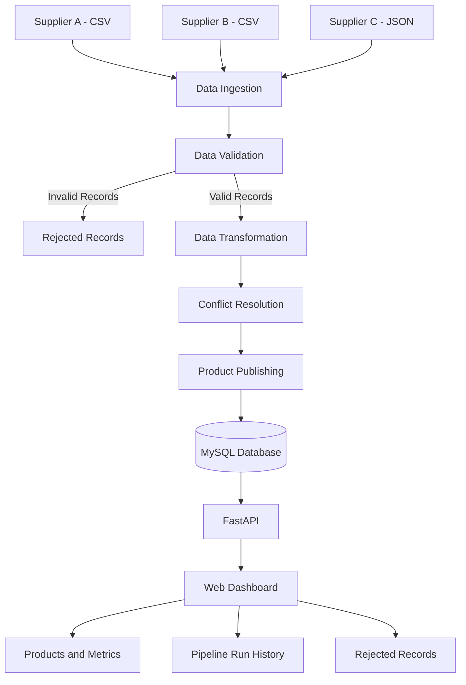

# System Architecture

The following diagram shows how data moves through the Multi-Supplier Product Integration Pipeline.

## Main Components

- **Supplier Feeds:** Product data comes from three different suppliers.
- **Ingestion:** Reads CSV and JSON files.
- **Validation:** Checks whether required product information is available.
- **Transformation:** Converts supplier data into a common format.
- **Conflict Resolution:** Selects preferred product values based on supplier priority.
- **Publishing:** Saves standardized products and source details in MySQL.
- **FastAPI:** Provides APIs to access pipeline data.
- **Dashboard:** Displays products, metrics, pipeline runs, and rejected records.